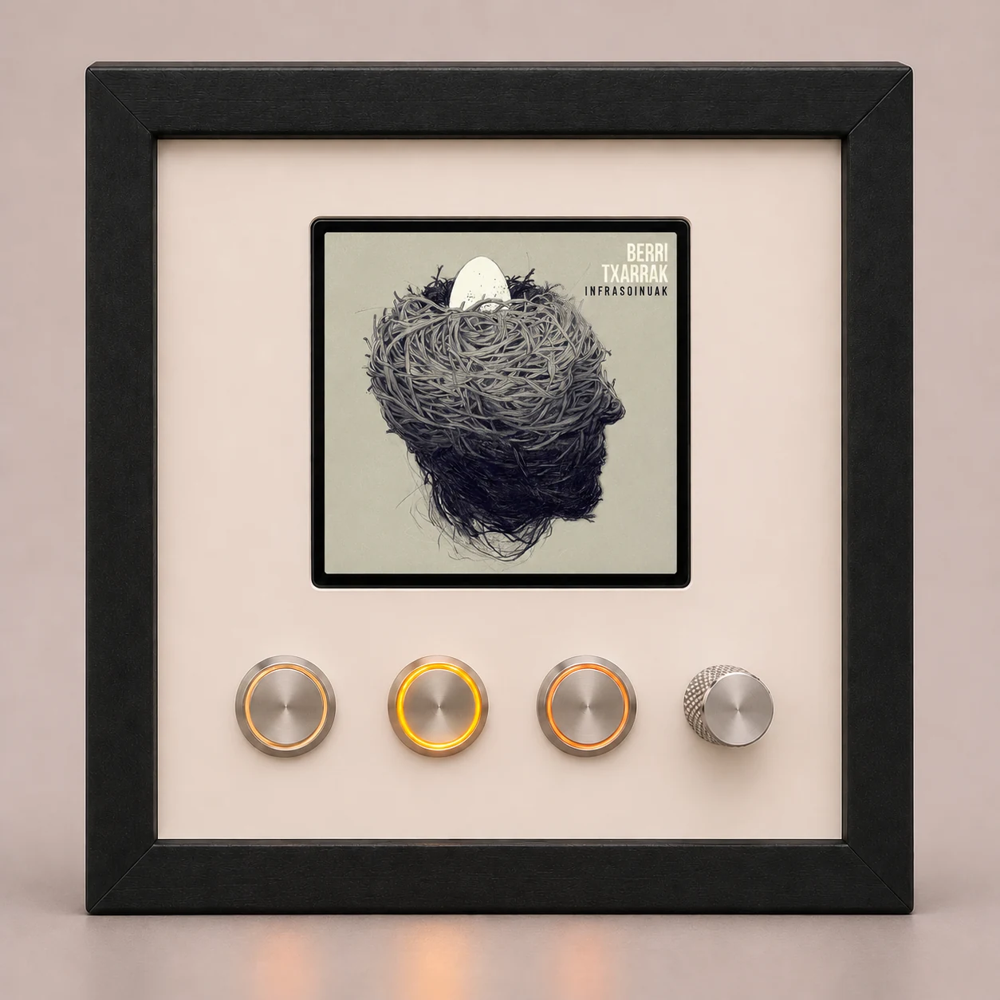

# Cuadro sonoro

Un cuadro decorativo que permite elegir tres canciones o emisoras desde una web y escucharlas mediante botones físicos. Una pequeña pantalla muestra carátulas o una imagen decorativa. **Sonoro** es el nombre provisional de la interfaz.

## Resultado final esperado



Imagen de referencia para presentar la propuesta estética; el diseño, las dimensiones y los materiales finales pueden cambiar. Los componentes del primer prototipo están seleccionados, pero el montaje y su validación física siguen pendientes. Consulta la [definición del proyecto](docs/DEFINICION.md), la [lista de materiales y esquema propuesto](docs/HARDWARE.md) y el [croquis preliminar de montaje](firmware/README.md).

**Estado:** Carlos confirma manualmente que el backend funciona en Render con RapidAPI. Codex no ha verificado el recorrido desde la web pública ni el hardware. La web estática está destinada a `https://sonoro.zeliuk.xyz` y llama a la API `https://cuadro-sonoro.onrender.com`; el despliegue web, HTTPS y CORS desde ese origen siguen pendientes de comprobación. La configuración RapidAPI y guías están en [estado](docs/ESTADO.md), [despliegue](docs/DESPLIEGUE.md) y [prueba](docs/PRUEBA_RAPIDAPI.md).

## Prueba la interfaz sin credenciales

Desde la raíz del repositorio, con Python 3 disponible:

```bash
python3 -m http.server 5173 --bind 127.0.0.1 --directory web
```

Abre [la interfaz local](http://127.0.0.1:5173) y pulsa «Probar demostración» para recorrerla sin backend. Para un cuadro real usa su enlace, que ya contiene el identificador; no hay que configurar una conexión desde la web. Se detiene con `Ctrl+C`. Los resultados y las barras son simulados y están identificados como demo; la demo actual todavía no reproduce audio de ejemplo.

La [maqueta interactiva del cuadro](web/maqueta/) tiene una página independiente: abre [http://127.0.0.1:5173/maqueta/#token=cuadro-demo](http://127.0.0.1:5173/maqueta/#token=cuadro-demo) con un ID de prueba. Consulta las selecciones publicadas y permite elegirlas con los pulsadores de la imagen; el audio se escucha en el navegador. El QR queda en pantalla si los tres huecos están vacíos. Consulta [web/README.md](web/README.md) para el funcionamiento y sus límites.

La vista para tablet está en `/tablet/`: abre [http://127.0.0.1:5173/tablet/#token=cuadro-demo](http://127.0.0.1:5173/tablet/#token=cuadro-demo). Muestra solo el cuadro y reutiliza la programación de `/maqueta`. Consulta [web/README.md](web/README.md) para instrucciones y límites.

## Producto definido

- Un identificador por cuadro relaciona su enlace QR/NFC, sus selecciones y el ESP32; no es una credencial.
- Tres huecos, cada uno con una canción o emisora; una importación por cuadro a la vez.
- Búsqueda de canciones con elección de versión y progreso de importación.
- Radio Browser como directorio de emisoras.
- Web dinámica, sin recargas completas y diseñada primero para móvil.
- Escucha de prueba en el navegador. El cuadro se controla con tres pulsadores iluminados y una rueda de volumen.
- Streaming Wi-Fi con búfer, sin microSD; arranque en silencio y parada al terminar una canción.
- Imagen decorativa elegida en la web y optimizada por el servidor.
- Configuración Wi-Fi local mediante QR y asistente, sin instalar una app.

La web pública decidida es `https://sonoro.zeliuk.xyz`; el QR/NFC usará `#token=<id-cuadro>`. El móvil necesita Internet, pero no la Wi-Fi del cuadro. El ESP32 tendrá un portal local independiente para configurar su Wi-Fi. Los gestos acordados son botón 1 mantenido 2 s para mostrar el QR musical durante 20 s y botones 2+3 mantenidos 5 s para restablecer únicamente Wi-Fi, con cuenta atrás cancelable. Son requisitos pendientes de firmware y validación en hardware. La [definición completa](docs/DEFINICION.md) es la referencia para implementar estos comportamientos. El procedimiento y antecedentes de RapidAPI están en [PRUEBA_RAPIDAPI.md](docs/PRUEBA_RAPIDAPI.md); Carlos comunica el backend operativo, sin validación independiente de Codex en esta fase.

## Arquitectura elegida

| Parte | Tecnología y ubicación |
|---|---|
| Web | HTML, CSS y JavaScript modular en `https://sonoro.zeliuk.xyz`; el móvil ejecuta la interfaz y accede por Internet. |
| API e importador | Python/FastAPI en Render; búsqueda yt-dlp y descarga RapidAPI; RTDB/Storage en Firebase. Carlos comunica que funciona con RapidAPI; Codex no ha verificado la web pública ni hardware. |
| Datos | Firebase Realtime Database. |
| Archivos preparados | Firebase Storage. |
| Dispositivo | Componentes seleccionados para el primer prototipo; montaje, firmware y validación física pendientes. |

La web se aloja fuera de Firebase Hosting y del ESP32. El ESP32 recibirá el audio directamente de Storage o de la emisora; hosting y backend no intervienen en cada reproducción de una canción ya preparada.

## Empezar a desarrollar

1. Lee [AGENTS.md](AGENTS.md) y [el primer encargo para Codex](docs/PRIMER_PASO_CODEX.md).
2. Sigue [la puesta en marcha](docs/PUESTA_EN_MARCHA.md).
3. Consulta [backend/README.md](backend/README.md) para instalar, arrancar, probar y detener la API.
4. Prueba los endpoints con [los ejemplos de API](docs/API.md) y su [prueba guiada](docs/PRUEBA_API.md).
5. Avanza siguiendo [el plan](docs/PLAN.md), manteniendo actualizadas las instrucciones.

Las instrucciones compartidas de ChatGPT se mantienen en [docs/INSTRUCCIONES_CHATGPT.md](docs/INSTRUCCIONES_CHATGPT.md). Si Codex las cambia, copiar de nuevo su contenido al proyecto ChatGPT y renovar los adjuntos de definición/estado que hayan cambiado.

## Mapa del repositorio

| Ruta | Contenido |
|---|---|
| `web/` | Diseño aprobado y prototipo dinámico. |
| `backend/` | API e importador iniciales; cada identificador válido deriva un ámbito aislado sin alta previa. |
| `firebase/` | Reglas de lectura por URL conocida, sin escrituras/listados, y guía del cliente directo. |
| `firmware/` | Alcance documentado; todavía sin firmware. |
| `docs/` | Definición, arquitectura, comandos, endpoints, fases y decisiones. |
| `scripts/` | Preparación local y verificaciones. |

Documentación adicional: [stack](docs/STACK.md), [configuración](docs/CONFIGURACION.md), [despliegue](docs/DESPLIEGUE.md), [publicación en GitHub](docs/PUBLICAR_GITHUB.md), [contribución](CONTRIBUTING.md) y [seguridad](SECURITY.md).

El primer hito real —buscar, importar, guardar audio e imagen en Firebase y probar el MP3 en navegador— está validado en [VALIDACION.md](docs/VALIDACION.md). Esto acredita Docker local, no un alojamiento accesible desde móvil ni la compatibilidad con un ESP32. La licencia del código y los recursos de demo está pendiente de elegir; no se atribuye una licencia abierta por defecto.
