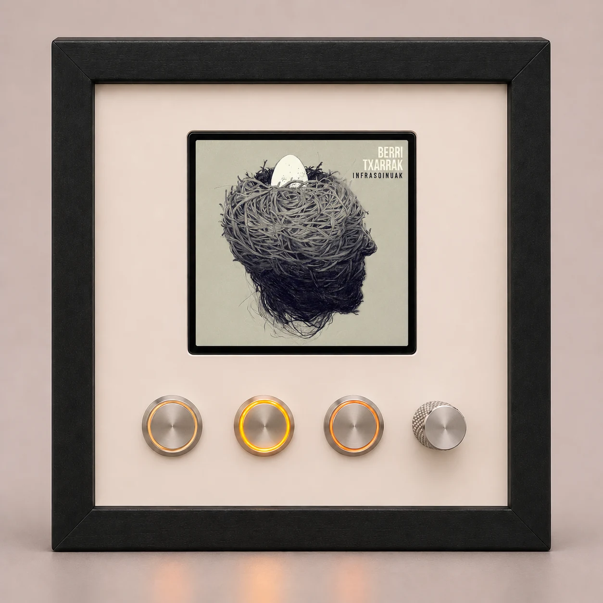

# Cuadro sonoro — Definición del proyecto

**Fecha:** 13 de noviembre de 2026

**Repositorio previsto:** `cuadro-sonoro`, público  
**Nombre visible provisional:** Sonoro  
**Estado:** decisiones de producto acordadas; implementación e integraciones por validar. Inicio aprobado del firmware real documentado como fase técnica de diagnóstico en `docs/ESTADO.md`; no modifica el comportamiento del producto definido aquí.

Este documento consolida la definición acordada antes de reconstruir el repositorio. Describe el comportamiento que debe tener el producto, no certifica que ya esté implementado. Las propuestas del prototipo anterior deben revisarse contra esta definición; en caso de contradicción, prevalecen las decisiones recogidas aquí.

## 1. Objetivo y alcance inicial

### Referencia visual del resultado

La imagen muestra una posible apariencia final del objeto: marco, pantalla con portada, tres pulsadores iluminados y rueda de volumen. Es una referencia estética, no un diseño industrial cerrado ni una garantía de que las dimensiones, materiales o componentes vayan a coincidir con el montaje final. La portada es un ejemplo visual.

Un cuadro decorativo con pantalla a color, altavoz y reproducción autónoma por Wi-Fi. Puede colgarse en la pared o apoyarse en una estantería. El móvil permite configurar sus selecciones; para escuchar no es necesario mantener la web abierta ni utilizar el teléfono.

La primera versión incluye tres selecciones independientes, cada una con una canción o una emisora. Las canciones se preparan previamente mediante un servicio externo y quedan almacenadas en Firebase. Las emisoras se escuchan directamente desde su streaming.

La experiencia debe resultar sencilla para regalar el cuadro a una persona sin conocimientos técnicos. Esa persona podrá configurar la Wi-Fi con su móvil, sin instalar una aplicación ni programar el dispositivo.

### Vista virtual para tablet

La web incluye una ruta opcional `/tablet/` que presenta únicamente el cuadro virtual, ajustado a la ventana y sin mostrar el marco de la fotografía de referencia. El fondo, la pantalla y su distribución se dibujan en la página; las imágenes de los pulsadores y del mando de volumen se montan individualmente. Reutiliza la programación de la maqueta: consulta las selecciones publicadas, permite escucharlas localmente con los pulsadores y simula los gestos del objeto. No controla el ESP32 ni cambia la configuración. El identificador se recibe igual que en la maqueta, desde `#token=`; se puede solicitar pantalla completa desde el navegador.

## 2. Acceso por QR/NFC y primera instalación

### Acceso habitual

- Cada cuadro usa un identificador de texto para relacionar su enlace, datos y dispositivo. Un identificador válido no requiere alta ni configuración previa.
- El identificador no es una credencial ni una prueba de identidad; no hay lista de cuadros permitidos, registro de usuarios ni Firebase Auth. Quien elija/conozca uno puede consultar y cambiar ese ámbito mediante la API.
- La web estática de configuración musical se publica en `https://sonoro.zeliuk.xyz`. El QR/NFC habitual abre ese origen con el identificador del cuadro en el fragmento, por ejemplo `https://sonoro.zeliuk.xyz/#token=cuadro-demo`. El ESP32 no aloja esta web; una actualización del hosting puede llegar a todos los cuadros sin actualizar sus dispositivos.
- La web acepta el identificador del fragmento, lo conserva en `sessionStorage` de la pestaña y limpia el fragmento de la barra de direcciones. El móvil necesita Internet para comunicarse con la web, Render y Firebase, pero no necesita estar en la misma Wi-Fi que el cuadro. El hostname `.local`, Bonjour/mDNS y el servidor local del Mac no forman parte del acceso habitual.
- El ESP32 mantiene un portal local independiente para configurar o restablecer su Wi-Fi. La contraseña se guarda en el dispositivo y no se envía al hosting, Render ni Firebase.
- No se plantea un registro ni un selector de usuarios para la primera versión. Quien tenga el enlace podrá consultar y cambiar la configuración de ese cuadro.
- Las selecciones pertenecen al cuadro y son compartidas entre quienes acceden desde distintos móviles.
- El identificador acepta entre 1 y 128 caracteres ASCII: letra o número inicial, luego letras, números, guion o guion bajo. La API lo conserva como Bearer por compatibilidad de transporte; el SHA-256 UTF-8 solo deriva el ámbito de almacenamiento.

### Configuración Wi-Fi

1. Al encenderse, el ESP32 comprueba si conserva credenciales Wi-Fi. Si no las tiene, inicia el modo de instalación y crea una red temporal con un nombre identificable por dispositivo, por ejemplo `Sonoro-Config-A1B2`.
2. La pantalla muestra «Vamos a conectar tu cuadro», instrucciones breves y un QR para conectarse a esa red. La red temporal está protegida por una contraseña propia del dispositivo, incluida en el QR; no es la contraseña doméstica.
3. La persona escanea el QR y confirma la conexión en el móvil. El cuadro intenta abrir automáticamente el portal cautivo. Si no aparece, muestra una dirección local de respaldo, por ejemplo `http://192.168.4.1`; la dirección definitiva queda pendiente de verificar al implementar el firmware.
4. El asistente local permite elegir una red doméstica, actualizar la lista de redes, escribir su contraseña y pulsar «Conectar cuadro». Funciona sin Internet, Render ni Firebase. Si el móvil avisa que la red temporal no tiene Internet, las instrucciones le indican permanecer conectado mientras configura el cuadro.
5. El ESP32 comprueba la conexión al router. Si falla, informa y permite corregir los datos sin reiniciar el proceso. La conexión al router y el acceso a Internet son estados distintos: no tener Internet no se interpreta automáticamente como contraseña incorrecta ni provoca borrar credenciales.
6. Cuando se establece la conexión al router, el cuadro conserva las credenciales para los siguientes encendidos, muestra el resultado y cierra la red temporal. Después muestra el QR habitual de la web musical con «Escanea para elegir tu música». El móvil vuelve a su conexión habitual para abrir la web; no se garantiza el cambio automático de red.

La contraseña de la red doméstica se conserva únicamente en el ESP32 y no se envía al hosting web, Render ni Firebase. El QR temporal de instalación y el QR/NFC habitual de configuración musical tienen funciones distintas. Con credenciales guardadas, una caída temporal del router o de Internet no las borra ni abre automáticamente el asistente: el cuadro informa del problema e intenta reconectar.

Para cambiar de router o corregir la red guardada, se mantiene pulsados juntos los botones 2 y 3 durante 5 segundos. Una cuenta atrás permite cancelar soltando cualquiera de ellos antes de completarla. El restablecimiento elimina únicamente las credenciales Wi-Fi y abre el asistente local; conserva identificador, selecciones, imagen decorativa y volumen. No es un borrado de fábrica ni elimina datos de Firebase.

## 3. Tres huecos y controles físicos

Cada hueco representa una única canción o emisora. No se incluyen listas de reproducción en la primera versión.

| Acción | Resultado |
|---|---|
| Pulsación corta en un hueco con contenido | Reproduce su selección. |
| Pulsación corta en otro hueco | Cambia a la selección de ese hueco. |
| Pulsación corta en el hueco activo | Detiene la reproducción y vuelve a la imagen decorativa. |
| Pulsación corta en un hueco vacío | Muestra el QR musical sin iniciar sonido; si ya suena otro hueco, conserva su audio. |
| Mantener botón 1 durante 2 segundos | Muestra durante 20 segundos el QR de la web musical, sin interrumpir el audio. |
| Mantener botones 2 y 3 juntos durante 5 segundos | Completa una cuenta atrás y restablece únicamente la Wi-Fi; después abre el asistente local. |
| Soltar cualquiera de los botones 2 o 3 antes de completar la cuenta atrás | Cancela el restablecimiento. |
| Girar la rueda | Ajusta únicamente el volumen del cuadro. No requiere pulsación ni tiene funciones adicionales. |

El QR musical se genera en el dispositivo a partir de su identificador estable; no se descarga desde Firebase ni cambia el identificador. Mantener el botón 1 para mostrarlo no inicia, cambia ni detiene el audio. Tras 20 segundos, la pantalla vuelve a lo que corresponda al estado actual: carátula o logo durante la reproducción, imagen decorativa en reposo.

Cuando el estado del cuadro indica que los tres huecos están vacíos, la pantalla muestra únicamente el QR musical de forma persistente para facilitar la primera configuración. Si hay al menos una selección y se pulsa un hueco vacío, el QR aparece durante 20 segundos; después vuelve a la selección activa o a la imagen decorativa. Mostrar el QR nunca inicia ni detiene audio.

El firmware debe tratar las pulsaciones largas y combinadas sin ejecutar también acciones cortas. La combinación 2+3 tiene prioridad sobre las acciones individuales; soltar tras una combinación no activa canciones y mantener pulsados los botones no repite continuamente la acción. Los tiempos de 2, 5 y 20 segundos son decisiones de producto pendientes de validar en hardware.

Habrá tres pulsadores momentáneos retroiluminados y un control físico de volumen, preferentemente una rueda. El componente concreto se elegirá con el hardware.

| Estado del hueco | Luz del pulsador |
|---|---|
| Vacío | Apagada. |
| Con selección disponible, sin sonar | Tenue. |
| Conectando o cargando audio para reproducir | Aumenta y disminuye suavemente. |
| Reproduciendo | Fija y más intensa. |
| Reproducción detenida o canción finalizada | Vuelve a tenue. |

Se mantiene la propuesta estética de un color cálido; el brillo y el modelo de pulsador se concretarán más adelante. La luz indica el estado del audio del cuadro, independiente del progreso de importación mostrado en la web.

## 4. Canciones y emisoras

### Añadir una canción

1. Abrir un hueco vacío o cambiar el contenido de uno ocupado.
2. Seleccionar «Canción» e introducir artista y título.
3. El backend usa yt-dlp para buscar y devuelve hasta cinco resultados con título, canal, miniatura y duración. Al elegir el resultado, el backend solicita a RapidAPI YouTube MP3 que prepare el audio del ID seleccionado.
4. La persona elige el resultado; no se importa automáticamente la primera coincidencia.
5. Se crea una tarea de importación. El servicio obtiene y prepara el audio, la imagen y los metadatos.
6. La web muestra su progreso. Cuando termina correctamente, la selección queda disponible.

No se utiliza la API de Spotify. La API RapidAPI prepara el MP3 tras la selección; FFmpeg/ffprobe valida el archivo en backend. `RAPIDAPI_KEY` se configura solo en el backend. yt-dlp se conserva para búsqueda, no para descargar audio. La importación RapidAPI debe validarse en el entorno elegido y puede consumir cuota; véase [PRUEBA_RAPIDAPI.md](PRUEBA_RAPIDAPI.md).

### Añadir una emisora

Radio Browser es el proveedor elegido para el directorio de emisoras. La web ofrecerá búsqueda por nombre, un filtro opcional por país y unas pocas sugerencias revisadas.

Los resultados mostrarán nombre, país y logo cuando esté disponible. Antes de asignar uno se comprobará el acceso a su emisión y su compatibilidad con el reproductor elegido. Se filtrarán resultados caídos o incompatibles y se tratarán los posibles duplicados.

Se guardan los datos de la emisora y la dirección de streaming. No se descarga ni se graba su programación. El ESP32 se conecta directamente a esa dirección. El directorio no debe ser una dependencia obligatoria en cada reproducción; se conserva también la identidad de la emisora para futuras actualizaciones de su enlace.

## 5. Importaciones, progreso y sustitución

- Se permite una importación por cuadro a la vez. Las otras selecciones siguen utilizándose mientras se procesa.
- Las tareas y su progreso se guardan fuera del navegador. Cerrar la web no cancela una tarea aceptada; al volver se recupera su estado.
- Se muestra actividad durante las etapas sin porcentaje medible y progreso real cuando la descarga o subida lo permitan. No se presentan porcentajes inventados como reales.
- La interfaz distingue búsqueda, descarga, preparación, guardado y resultado final.
- Si una importación falla, se conserva la selección anterior y se ofrece reintentar o cancelar.
- Se admite cancelación y se limpian los archivos temporales y resultados que queden sin utilizar.
- Una tarea completa solo publica una selección cuando audio, imagen y metadatos necesarios están preparados.

La ejecución debe soportar interrupciones y evitar duplicar publicaciones o borrar contenido vigente al reintentar. Guardar el estado en Firebase no sustituye por sí solo un mecanismo fiable de ejecución. Carlos comunica manualmente que el backend funciona en Render con RapidAPI. Esta comunicación no acredita aquí resultados de importaciones concretas ni constituye una verificación de Codex; revisar el estado en ESTADO.md. El diagnóstico histórico HTTP 429/403 fue de descarga yt-dlp y no describe RapidAPI ni constituye un bloqueo vigente de esa descarga.

### Si el hueco está sonando durante un cambio

La reproducción anterior continúa hasta que se detenga o termine la canción. Guardar una selección desde la web no inicia sonido ni corta lo que estaba sonando. Si el hueco está sonando, conserva el audio y sus metadatos activos; la selección nueva se utiliza la próxima vez que se active. Pulsar el botón activo continúa significando «detener».

## 6. Reproducción y escucha desde la web

### En el cuadro

- El ESP32 no lleva microSD ni almacena canciones completas de forma permanente.
- Recibe el MP3 directamente desde Firebase Storage y lo reproduce por streaming con un búfer en memoria.
- No espera a descargar el archivo completo para empezar. El objetivo es un inicio en pocos segundos con una conexión estable; el tiempo real se medirá con el hardware.
- El backend interviene en la incorporación de contenido, no en el recorrido normal del audio ya preparado.
- Al terminar una canción se detiene. No repite ni salta automáticamente a otro hueco.
- Las emisoras continúan hasta detenerlas, cambiar de selección o encontrar un problema de conexión que impida seguir.
- Al encender o reiniciar, el cuadro muestra la imagen decorativa y permanece en silencio. Conserva selecciones y último volumen utilizado.
- El volumen se controla con la rueda física. No se incluye ajuste remoto de volumen desde la web.

### En la web

Cada selección ofrece «Escuchar aquí» con un icono de play sobre la portada; mientras suena, el mismo control muestra stop. El sonido se reproduce en el navegador y no se envían órdenes al cuadro. No se abre un panel de reproducción separado.

Para canciones, la prueba está disponible después de completar la importación y utiliza el mismo MP3 definitivo. Se reproduce una única selección a la vez en la web. La escucha de prueba es independiente del sonido y el volumen físicos del cuadro.

Para emisoras, la escucha en el navegador queda sujeta a que el stream permita reproducción web; esta compatibilidad debe comprobarse aparte de la del ESP32.

No se incluyen comandos remotos de reproducir, detener o volumen dirigidos al cuadro en esta versión. La web modifica configuración y permite escuchar localmente; los botones y la rueda gobiernan el dispositivo.

## 7. Concepto físico y hardware del primer prototipo

El objeto podrá colgarse o apoyarse. Se busca un frente decorativo de vidrio o metacrilato con la pantalla integrada y el sistema oculto detrás.

Como concepto, una lámina, impresión o zona opaca oculta cables y componentes, dejando una ventana para la pantalla. Una pieza o franja inferior puede alojar los pulsadores y la rueda; sus cables pasan directamente a la carcasa trasera. No se pretende que todo el frontal sea transparente y deje la electrónica visible.

Para el primer prototipo se seleccionaron la Waveshare ESP32-S3-Touch-LCD-4B, el expansor AW9523B, tres pulsadores RGB de 5 V y un encoder EC11. Decisiones de desarrollo aprobadas: ESP-IDF 5.5.5, BSP Waveshare 2.0.0, LVGL 9.5.0 compartido entre escritorio y firmware, C++17, simulador SDL2, VS Code/Codex y transferencia inicial por USB; OTA queda como posibilidad futura no implementada. La lista completa, asignaciones y esquema propuesto están en [HARDWARE.md](HARDWARE.md), referencia única para materiales, cableado y comprobaciones de banco. Esta decisión documental no confirma las piezas recibidas ni que el circuito sea eléctricamente compatible. El pinout, la dirección I²C, corrientes, estados de arranque, alimentación de los aros y pull-ups deben comprobarse antes del montaje.

Siguen pendientes la validación de banco, el montaje y su validación física; también medidas, material definitivo, alimentación final, comprobación del altavoz incluido, construcción de la carcasa y funcionamiento de pantalla, audio y controles. La selección de componentes no equivale a un prototipo montado ni a firmware implementado.

## 8. Pantalla e imágenes

| Estado | Contenido |
|---|---|
| En reposo | Imagen decorativa independiente, elegida desde la web. |
| Canción reproduciéndose | Carátula, título y artista. |
| Emisora reproduciéndose | Logo y nombre. |
| Conectando al audio | Imagen de la selección e indicador de carga. |
| Ajustando volumen | Nivel de volumen durante unos segundos. |
| Configurando Wi-Fi | QR, instrucciones y resultado del asistente. |
| Restableciendo Wi-Fi | Cuenta atrás de confirmación. |
| Problema de conexión | Mensaje comprensible. |

La pantalla será a color, sin necesidad de función táctil ni vídeo en la primera versión. La información de canción en una emisora solo podrá considerarse una mejora posterior si los metadatos del stream lo permiten; no es requisito para su funcionamiento.

### Imagen decorativa

1. La persona sube una imagen normal desde el móvil u ordenador.
2. La web muestra una vista previa con la proporción real de pantalla y permite ajustar el encuadre.
3. El backend valida el archivo, corrige orientación, aplica encuadre, adapta resolución y comprime.
4. Se eliminan metadatos innecesarios, incluida ubicación GPS cuando exista.
5. Se guarda la versión optimizada y se actualiza la configuración cuando esté lista.

La salida actual de carátula se adapta a 480 × 480 para la pantalla seleccionada. Para canciones, el backend intenta las miniaturas de YouTube de mayor a menor resolución y recorta al centro; el tratamiento final debe evitar perder información relevante. Formato, calidad y peso máximo definitivos se revisarán con la pantalla. No se conserva el original como archivo permanente. Carátulas y logos también se optimizan.

La imagen anterior permanece hasta completar la nueva. Al terminar o detener el sonido se vuelve a la imagen decorativa. El detalle de su conservación local y la presentación en arranque sin red se resolverá al implementar el firmware, sin añadir almacenamiento de canciones completas.

## 9. Acceso y protección de datos

El modelo de producto es seleccionar el cuadro con el identificador que aparece en el enlace. No hay roles de propietario e invitado ni inicio de sesión para el destinatario. Un identificador nuevo crea su registro; el mismo recupera la selección. El desarrollador puede fijar el identificador en QR/NFC, pero no necesita registrarlo en una allowlist.

La decisión de Carlos es que la configuración musical publicada y los medios se pueden leer sin sesión para quien conozca sus URLs. RTDB permite GET solo en `frames/{sha256}/slots`; no permite leer el árbol de cuadros ni tareas. Storage permite GET de objetos por URL bajo `private/frames/{sha256}/`, pero no listar objetos. La API deriva la misma ruta SHA-256 del identificador y no comprueba una lista de autorización. Conocer o elegir un identificador permite cambiar su configuración mediante la API; SHA-256 separa rutas, no autoriza. Las credenciales administrativas permanecen solo en backend y herramientas privadas. No hay cuentas, contraseñas ni sesiones Firebase.

Las credenciales administrativas, archivos de cuentas de servicio y claves privadas no se publican en GitHub, capturas, documentación de ejemplo o registros de diagnóstico. La contraseña doméstica se mantiene en el ESP32. Las reglas y una importación/reproducción se validaron en Firebase real con cambios manuales permitidos; el firmware de producto sigue pendiente. Existe un firmware v0.1 separado para diagnóstico de pantalla, sin validar físicamente todavía.

## 10. Datos, conservación y limpieza

| Lugar | Contenido |
|---|---|
| Realtime Database | Cuadros, relación con su acceso, tres selecciones, imagen decorativa y tareas con su estado/progreso. |
| Firebase Storage | MP3 e imágenes optimizadas que siguen en uso y resultados temporales necesarios para una sustitución. |
| ESP32 | Configuración técnica, Wi-Fi, último volumen y los datos necesarios para funcionar; audio solo en búfer. |
| Navegador en demo | Datos ficticios separados del sistema real. |

No se construye una biblioteca histórica ilimitada. Al sustituir o eliminar contenido se borran los archivos y metadatos que dejan de tener referencias. Si un recurso está compartido entre huecos o cuadros, o sigue utilizándose en una reproducción, se conserva mientras corresponda.

Durante una sustitución pueden coexistir temporalmente la versión anterior y la nueva. También se limpia contenido abandonado por fallos y cancelaciones. El detalle de referencias de reproducción, plazos de limpieza y política de borrado del bucket debe concretarse para que la limpieza sea segura y predecible.

## 11. Stack y arquitectura

| Componente | Elección |
|---|---|
| Web | HTML, CSS y JavaScript en módulos, manteniendo el diseño aprobado. |
| API | Python con FastAPI. |
| Importador | Búsqueda yt-dlp; descarga MP3 mediante RapidAPI; FFmpeg/ffprobe y procesamiento de imágenes en backend. |
| Backend externo | Docker; alojamiento público por decidir. En desarrollo local se usa Docker en el Mac. |
| Datos | Firebase Realtime Database. |
| Audio e imágenes | Firebase Storage. |
| Firmware | ESP-IDF 5.5.5, C++17, BSP Waveshare 2.0.0 y LVGL 9.5.0; la fase v0.1 es solo diagnóstico y no implementa todavía las funciones de producto. |

La web será dinámica: búsquedas, resultados, formularios, progreso, actualización de huecos, imagen y escucha local funcionan sin recargas completas durante el uso normal. La interfaz separa estilos, componentes visuales, servicios de comunicación y lógica de estado.

Diseño primero para móvil: una columna cuando corresponda, controles cómodos, ventanas adaptadas al teclado y sin desbordamientos, imágenes optimizadas, audio iniciado por acción del usuario, dependencias mínimas y peticiones limitadas a lo necesario. El procesamiento pesado se realiza en el backend.

La configuración publicada y lo que está reproduciéndose son estados distintos. No se debe afirmar que el ESP32 ha aplicado un cambio por el mero hecho de guardarlo en Firebase. Tampoco se requiere añadir un panel de órdenes remotas para cumplir la configuración básica.

## 12. Alojamiento, coste y recuperación

- La web estática se aloja en `https://sonoro.zeliuk.xyz`, sin Firebase Hosting. El contenido de `web/` se publica en el hosting HTTPS de Carlos; no se conocen aquí proveedor, panel, credenciales ni comandos de subida.
- El navegador ejecuta la web y llama a `https://cuadro-sonoro.onrender.com` para operaciones de configuración, búsqueda e importación. CORS debe permitir el origen exacto `https://sonoro.zeliuk.xyz` mediante `ALLOWED_ORIGINS` (sin barra final); los orígenes de desarrollo existentes se conservan para desarrollo. Esto documenta la configuración requerida, no confirma que Render esté configurado así.
- RTDB conserva configuración/selecciones/estados y Storage conserva audio e imágenes. El ESP32 consulta su configuración y reproduce MP3 directamente desde Storage o emisoras desde sus streams. Hosting y Render no participan en el recorrido normal del audio preparado. No se necesita servidor doméstico ni Raspberry Pi por cuadro.
- La integración RapidAPI requiere `RAPIDAPI_KEY` solo en backend; `RAPIDAPI_USERNAME` también permanece en backend según la implementación actual.
- Firebase proporciona datos y almacenamiento de archivos. Sus cuotas, región y configuración de facturación se revisarán antes del despliegue. Storage requiere Blaze; no se garantiza coste cero.
- La ejecución fiable de trabajos en varias instancias queda fuera de esta prueba; mantener una instancia y un worker. Carlos comunica que el backend funciona en Render con RapidAPI, sin que esta fase documental verifique la ejecución remota o el recorrido desde el dominio web. No se dará por garantizada la continuidad de una tarea por dejarla en un proceso de fondo sin recuperación.
- Cada reproducción desde Storage genera tráfico de salida, aunque solo existan tres selecciones y se limpie contenido antiguo.

| Incidencia | Comportamiento acordado |
|---|---|
| Búsqueda fallida | Mensaje y opción de reintentar. |
| Importación fallida | Mantener selección previa, reintentar o cancelar. |
| Cerrar la web | Recuperar configuración y estado de tareas al volver. |
| Error al escuchar en el navegador | Informar y permitir reproducir de nuevo. |
| Caída de internet en el cuadro | Intentar reconectar; si se agota el búfer, detener e informar. |
| Caída temporal de red | Conservar credenciales Wi-Fi y selecciones. |

Queda pendiente fijar si el cuadro reanuda automáticamente un audio interrumpido por la red. Sí está decidido que el encendido y reinicio no arrancan música automáticamente.

## 13. Identidad y demostración

El repositorio se llama `cuadro-sonoro`. Sonoro continúa como nombre provisional de la interfaz. Se conserva el lenguaje visual cálido y decorativo del prototipo aprobado; no se rediseña por introducir organización modular.

Habrá un modo demostración para portfolio, utilizable sin credenciales y claramente identificado. Usará datos y recursos de ejemplo separados, sin acceder a cuadros reales, crear importaciones reales ni generar costes en los servicios del proyecto.

La demo podrá simular el flujo y el progreso, indicando que son simulaciones. Sus recursos de audio e imagen deben ser adecuados para publicarse junto al proyecto. La demo no demuestra por sí misma el funcionamiento real de YouTube, Firebase, la API o el ESP32.

## 14. Repositorio, documentación y forma de trabajar

Un único repositorio con esta separación:

| Carpeta | Responsabilidad |
|---|---|
| `web/` | Interfaz y modo demostración. |
| `backend/` | API, importador, procesamiento y pruebas. |
| `firmware/common/` | Vistas LVGL, QR e imágenes que pueden compartir escritorio y firmware. |
| `firmware/simulator/` | SDL2, teclado, acceso a archivos/red y modo Firebase de escritorio. |
| `firmware/esp32/` | Proyecto ESP-IDF para la placa; actualmente modo diagnóstico v0.1. |
| `firebase/` | Configuración y reglas versionables sin credenciales. |
| `docs/` | Arquitectura, decisiones, configuración, despliegue y fases. |

El README presentará el proyecto, funcionamiento, demo, instalación y estado real. `AGENTS.md` explicará cómo trabajar, documentos que leer, límites del alcance, convenciones y verificaciones. Se mantendrán documentación de arquitectura, stack, configuración, seguridad, contribución y primer encargo para Codex.

Credenciales administrativas en variables de entorno o mecanismos privados del proveedor, con plantillas vacías. Una variable enviada al navegador es visible para ese navegador aunque proceda de un `.env`; el identificador de cuadro no es secreto, pero las credenciales Admin permanecen en backend.

El trabajo se divide en cambios pequeños, con comprobaciones relevantes y revisión móvil. Se respetan los cambios existentes y se actualizan los documentos cuando cambie una decisión. No se añade un framework por defecto ni se confunde una comprobación con mocks con una integración verificada.

### Instrucciones compartidas con ChatGPT

Las instrucciones del proyecto ChatGPT se versionan en `docs/INSTRUCCIONES_CHATGPT.md`, dentro del mismo repositorio. Git es la referencia de ese texto. Codex lo actualiza cuando cambien producto, alcance, stack o forma de trabajo y avisa de ello al cerrar la tarea. Carlos copia manualmente el contenido actualizado a las instrucciones de ChatGPT y renueva los adjuntos de definición/estado cuando corresponda. No hay sincronización automática entre esos archivos y el proyecto ChatGPT.

### Documentación operativa obligatoria por componente

La documentación debe permitir arrancar y probar cada parte desde una instalación limpia, sin depender de explicaciones del chat. No basta con describir la arquitectura: se incluyen los comandos completos y la respuesta esperada de cada comprobación. Cada carpeta tendrá un README operativo, enlazado desde el README raíz, y guías específicas cuando el detalle lo justifique.

| Componente | Instrucciones y comandos que debe incluir |
|---|---|
| `web/` | Requisitos, demo, publicación estática HTTPS, URL pública con identificador, conexión con la API y comprobaciones disponibles. Los servidores locales son herramientas de desarrollo. |
| `backend/` | Versiones y dependencias, entorno virtual, instalación, plantilla de variables, arranque local y con Docker, ejecución de las tareas en segundo plano, pruebas, logs y parada. El alojamiento externo queda por elegir. |
| `firebase/` | Creación/configuración de recursos, conexión desde el backend, reglas, comandos de validación y despliegue cuando corresponda, emuladores si se incorporan y verificación de acceso con un cuadro de prueba. |
| `firmware/` | Al abordar esta fase: herramientas, preparación privada del cuadro, compilación, carga por USB, monitor serie, configuración Wi-Fi, pruebas de audio/pantalla/controles y restablecimiento Wi-Fi. |
| `docs/` | Guía de inicio completa, catálogo de API, recorrido de prueba paso a paso, despliegue y resolución de problemas habituales. |

Cada bloque de comandos indicará desde qué carpeta ejecutarlo, qué requisitos debe tener instalados la persona, qué variables de ejemplo necesita y qué resultado debe obtener. Se distinguirá terminal anfitrión, entorno virtual y contenedor; también los comandos locales y los de despliegue. Se documentará cómo detener los procesos y limpiar recursos de prueba sin borrar configuración o archivos reales. La ruta recomendada se explicará de principio a fin; las alternativas solo se incluirán si están soportadas.

### Documentación detallada de la API

El backend tendrá un catálogo de todos los endpoints implementados, complementado con documentación interactiva basada en OpenAPI. El catálogo explicará el propósito y el uso real de cada operación, incluyendo:

- Método HTTP, ruta, URL base y uso del identificador del cuadro para seleccionar el ámbito; no hay autorización por usuario.
- Parámetros de ruta y consulta, cabeceras, cuerpo JSON o subida de archivos, campos obligatorios, tipos y límites.
- Ejemplo completo de llamada con `curl`, usando identificadores y datos ficticios, con las variables necesarias definidas de forma explícita.
- Ejemplo de respuesta, códigos HTTP relevantes y errores habituales con su significado y forma de resolverlos.
- Si una operación es síncrona o crea una tarea; identificador de tarea, estados, consulta o seguimiento del progreso, cancelación, reintento y comportamiento ante solicitudes repetidas cuando corresponda.
- Recursos que modifica, archivos que crea o elimina y condiciones para publicar la nueva selección.
- Diferencias entre modo demostración, proveedores simulados, emuladores y servicios reales, cuando proceda.

Se cubrirán las operaciones que realmente existan para búsqueda de canciones y emisoras, importación y tareas, consulta/actualización de los tres huecos, imágenes y comprobación de disponibilidad del servicio. Esta lista describe capacidades que deben quedar documentadas, no fija todavía nombres de rutas. No se añadirán endpoints de control remoto del sonido del cuadro, que quedan fuera del alcance inicial.

Habrá además un recorrido reproducible de prueba manual: arrancar los servicios, comprobar su disponibilidad, buscar una canción, elegirla, iniciar la importación, seguir su estado, comprobar la selección publicada y escuchar el archivo final en el navegador. Se documentarán también el caso de error y la conservación de la selección anterior. Las pruebas que generen consumo real o modifiquen datos se identificarán, empleando un cuadro y recursos destinados a pruebas.

### Regla para Codex y mantenimiento de las instrucciones

`AGENTS.md` exigirá actualizar las guías y los ejemplos en el mismo cambio que modifique rutas, campos, variables, comandos o comportamiento. Los comandos y ejemplos se contrastarán con el código y se ejecutarán cuando el entorno lo permita; se indicará cualquier paso pendiente de verificación. No se presentarán rutas propuestas como endpoints ya disponibles ni comandos sin comprobar como una puesta en marcha validada.

Esta definición incorpora el requisito documental. El catálogo con comandos y rutas concretos se elaborará al preparar la base ejecutable y evolucionará junto a su implementación.

### Orden de validación

1. Consolidar esta definición en la documentación y preparar una base coherente de repositorio.
2. Validar el recorrido real desde `https://sonoro.zeliuk.xyz`: buscar, elegir, procesar desde la API alojada, publicar medios en Firebase y escuchar la prueba en el navegador.
3. Completar la web dinámica conectada a tareas reales, incluyendo progreso, reintentos, sustitución y limpieza; validar búsqueda y escucha de Radio Browser en navegador y después en ESP32.
4. Elegir hardware y validar reproducción de MP3 y radio por Wi-Fi, controles físicos y volumen.
5. Integrar pantalla, imagen decorativa, luces y asistente Wi-Fi; comprobar recuperación y cambios durante reproducción.
6. Resolver diseño físico y documentar montaje y despliegue reproducibles.

### Pendientes antes o durante la implementación

- Placa, memoria, pantalla, audio, alimentación, ruedas/pulsadores, pines y medidas.
- Lectura autónoma del ESP32 y reglas de acceso directo a Firebase.
- Ejecución y recuperación de tareas, coordinación entre workers y verificación independiente y detallada del flujo RapidAPI desde el origen web público. Carlos comunica que el backend funciona en Render. La búsqueda yt-dlp en Render tuvo errores históricos HTTP 429/403; no se ha probado en Raspberry Pi ni en una red doméstica.
- Duración máxima de canciones, tiempos máximos de tareas, calidad MP3 y límites de subida de imágenes.
- Resolución y formato de imágenes, brillo de pantalla, dirección definitiva del portal y validación en hardware de los tiempos acordados de 2, 5 y 20 segundos.
- Conservación local de la imagen decorativa y comportamiento de pantalla sin red.
- Política de limpieza de recursos en uso, retención de estados de tareas y configuración de borrado del bucket.
- Comportamiento de reanudación tras una interrupción de audio por la red.
- Licencia del código y recursos publicables de demostración.

Estos pendientes no sustituyen las decisiones de producto ya acordadas. Se resolverán en su fase, documentando el resultado antes de extender el alcance.

### Referencias técnicas consultadas durante la definición

- [Render: Docker](https://render.com/docs/docker)
- [Render: servicios gratuitos](https://render.com/docs/free)
- [Firebase: precios y cuotas](https://firebase.google.com/pricing)
- [Firebase: requisitos de Storage](https://firebase.google.com/docs/storage/faqs-storage-changes-announced-sept-2024)
- [Radio Browser: API](https://docs.radio-browser.info/)
- [Espressif: reproducción y ejemplos multimedia](https://docs.espressif.com/projects/esp-adf/en/latest/multimedia-examples/index.html)
- [WiFiManager: configuración Wi-Fi mediante portal cautivo](https://github.com/tzapu/WiFiManager)

Los límites y condiciones de los proveedores pueden cambiar; se comprobarán de nuevo al desplegar.
