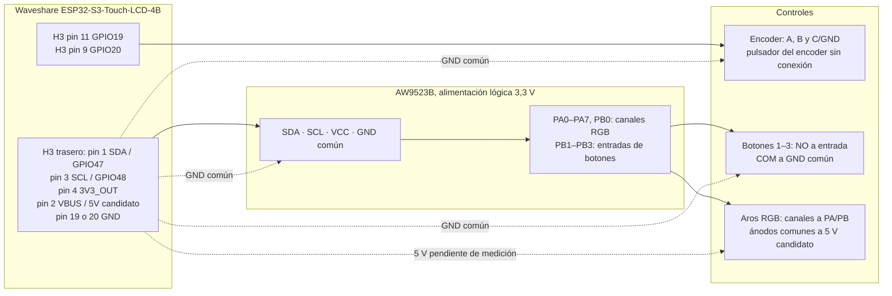

# Hardware del primer prototipo

Selección documental para el primer prototipo. El esquema es una propuesta derivada de la documentación enlazada y de las piezas seleccionadas; no acredita que el montaje se haya hecho o probado. No conectar los aros ni los contactos hasta completar las comprobaciones de banco de esta guía.

## Lista de materiales

| Cantidad | Componente seleccionado | Estado y comprobación pendiente |
|---:|---|---|
| 1 | Waveshare ESP32-S3-Touch-LCD-4B, SKU 32052, pantalla cuadrada de 4 pulgadas, 480 × 480 | Seleccionada para el prototipo; verificar la unidad recibida, marco, panel y fijaciones. |
| 1 | Waveshare AW9523B IO Expansion Board, SKU 22132, con cable PH2.0 de seis vías | Seleccionado; confirmar orientación y señales del cable antes de energizar. |
| 3 | Pulsador metálico de 16 mm, acero inoxidable, aro RGB 5 V, ánodo común y seis terminales | Compra hecha. Comprobar continuidad, contactos momentáneos normalmente abiertos, pinout, resistencias integradas y corriente de cada color antes de conectar. |
| 1 | Encoder DQLZV EC11 de 5 pines, variante Half axis 15 mm, con tuerca | Seleccionado. El eje D mide 15 mm; verificar al recibir que el diámetro sea 6 mm. |
| 1 | Pomo de aluminio plateado para eje de 6 mm, con tornillo lateral | Seleccionado sujeto a confirmar ajuste con el encoder recibido. |
| 5 × 10 m | Cable flexible de silicona, cobre estañado multifilar, 26 AWG, cinco colores | Seleccionado para señal y cableado de prototipo; confirmar calibre y longitud recibidos. |
| 1 tramo | Tira macho recta 2×40, paso 2,00 mm; cortar 2×10 para H3 | Seleccionada; comprobar paso y orientación antes de insertarla. |
| 1 | Termorretráctil negro, 2 mm de diámetro interior | Seleccionado. |
| 1 | Cargador USB de 5 V y cable USB de datos | Alimentación prevista; verificar etiquetado/capacidad del cargador. Usar USB TO UART para alimentación y programación cuando el encoder esté conectado. |
| Por confirmar | Marco, panel, fijaciones y altavoz | Comprobar las piezas recibidas. La 4B tiene salida para altavoz; verificar si la unidad trae altavoz antes de comprar otro. |

## Esquema propuesto

H3 es el conector trasero de expansión de la Waveshare 4B. “Pin H3” identifica la posición física del conector; “GPIO” identifica el número de señal del ESP32-S3. No son números intercambiables. La rama de 5 V a los comunes positivos está deliberadamente pendiente de confirmar con multímetro.

La 4B comparte el bus I²C con periféricos de la propia placa. INT y RST del módulo AW9523B quedan sin cablear en esta primera prueba; se usará sondeo, siguiendo la guía del módulo. Verificar la dirección I²C según el estado de A0/A1.

### Botones integrados de la placa (uso provisional de diagnóstico)

La placa incluye `BOOT` y `PWR`; pueden simular temporalmente los huecos 1 y 2 en el diagnóstico mientras no estén los pulsadores externos. El esquema Waveshare conecta `BOOT` a GPIO0 (activo en bajo) y la señal de `PWR` a la entrada P4/EXIO4 del expansor **TCA9554 integrado en la propia Waveshare** (activo en alto). En el conector H3, EXIO4 corresponde al pin 14. El AW9523B externo no interviene en estas lecturas. PWR también forma parte del control de energía de la placa, por lo que para esta prueba solo se usan pulsaciones cortas. Estos botones no forman parte de los controles previstos en el producto final.

Fuentes: [esquema oficial Waveshare ESP32-S3-Touch-LCD-4B](https://files.waveshare.com/wiki/ESP32-S3-Touch-LCD-4B/ESP32-S3-Touch-LCD-4B.pdf) y [documentación del fabricante](https://docs.waveshare.com/ESP32-S3-Touch-LCD-4B).

### Asignación de señales y conexiones propuestas

| Elemento/origen | Pin o señal destino | Conexión y nota |
|---|---|---|
| 4B, H3 pin 1, SDA / GPIO47 | AW9523B SDA | Número físico H3 y GPIO se indican por separado. Bus compartido en la 4B. |
| 4B, H3 pin 3, SCL / GPIO48 | AW9523B SCL | Verificar dirección I²C según A0/A1. |
| 4B, H3 pin 4, 3V3_OUT | AW9523B VCC | Alimentación lógica, línea de 3,3 V. |
| 4B, H3 pin 19 o 20, GND | AW9523B GND | Masa común para las señales. |
| AW9523B INT y RST | Sin cablear | Primera prueba por sondeo. |
| 4B, H3 pin 11, GPIO19 | Encoder A | Identificar A/B/C recibido. Prever pull-up a 3,3 V. GPIO19/20 comparten función con USB nativo: con encoder conectado, alimentación y programación por USB TO UART. |
| 4B, H3 pin 9, GPIO20 | Encoder B | Prever pull-up a 3,3 V. |
| GND común | Encoder C | Confirmar terminal C según el componente recibido. |
| Encoder, dos terminales de pulsador | Sin conectar | El pulsador integrado no se usa en esta fase. |
| Aro 1, canal rojo / verde / azul | AW9523B PA0 / PA1 / PA2 | Asignación propuesta. |
| Aro 2, canal rojo / verde / azul | AW9523B PA3 / PA4 / PA5 | Asignación propuesta. |
| Aro 3, canal rojo / verde / azul | AW9523B PA6 / PA7 / PB0 | Asignación propuesta. |
| Pulsador 1, contacto NO | AW9523B PB1 | Prever pull-up de 10 kΩ a 3,3 V; comprobar si el módulo ya lo incluye. |
| Pulsador 2, contacto NO | AW9523B PB2 | Prever pull-up de 10 kΩ a 3,3 V; comprobar si el módulo ya lo incluye. |
| Pulsador 3, contacto NO | AW9523B PB3 | Prever pull-up de 10 kΩ a 3,3 V; comprobar si el módulo ya lo incluye. |
| Pulsadores 1–3, contacto COM | GND común | Cierra a masa al pulsar, sujeto a verificar NO/COM por continuidad. |
| Aros 1–3, común positivo (ánodo común) | 5 V candidato: 4B H3 pin 2 VBUS/5V_IN | Pendiente de medición. Línea distinta de 3V3_OUT; no conectar antes de confirmar tensión/corriente. |

Antes de conectar los contactos, comprobar el estado de todos los puertos AW9523B al arranque. La ficha Awinic indica que tras encender, los 16 puertos quedan como salidas GPIO y sus valores dependen de AD0/AD1. Configurar estados seguros antes de conectar cargas. No asumir que las salidas son de drenador abierto ni que el módulo incorpora pull-ups o resistencias de LED sin verificarlo en la placa y su guía.

## Comprobaciones de banco antes de cerrar el circuito

1. **Sin alimentar**, usar continuidad para identificar en cada pulsador los contactos momentáneos normalmente abiertos; mapear los seis terminales, polaridad y conexiones de cada color. Medir o confirmar resistencias integradas y calcular/medir corriente prevista por color a 5 V. No alimentar un aro hasta conocer este dato.
2. **AW9523B sin cargas externas**, verificar VCC/GND, orientación del PH2.0, dirección I²C con A0/A1 y funcionamiento del sondeo en el bus compartido. Revisar con el arranque la configuración y estado efectivo de PA/PB; todavía no conectar botones ni LED.
3. Medir H3 pin 2 respecto a GND con la 4B alimentada por USB TO UART. Confirmar tensión y disponibilidad real de VBUS/5V_IN en esa condición. No conectar los tres aros a esa línea hasta verificar fuente, corriente total y comportamiento bajo carga.
4. **Un solo aro y un solo color:** verificar terminales y modo eléctrico compatible con el AW9523B; observar sus salidas durante arranque; medir corriente con el aro nominal de 5 V. Inicializar brillo en cero y aumentarlo desde un valor bajo. Detenerse si la corriente, tensión o temperatura no son correctas.
5. Comprobar los contactos de botón y pull-ups de 10 kΩ a 3,3 V. Decidir si hacen falta resistencias adicionales solo después de inspeccionar el pulsador recibido y comprobar el módulo; la selección de valores queda pendiente.
6. Validar el encoder (A/B, pull-ups, sentido y rebote) y después probar los tres aros juntos, midiendo la corriente total y observando caídas o reinicios. Esta validación física no se ha realizado.

No usar alimentación USB nativa de la 4B para programar mientras GPIO19/20 estén conectados al encoder. No dejar una fuente de 5 V conectada a los ánodos hasta confirmar con multímetro que el punto candidato está presente y que la fuente admite la carga prevista. La documentación aquí no sustituye medición, limitación de corriente ni validación del circuito recibido.

## Fuentes del fabricante

- [Esquema oficial Waveshare ESP32-S3-Touch-LCD-4B](https://files.waveshare.com/wiki/ESP32-S3-Touch-LCD-4B/ESP32-S3-Touch-LCD-4B.pdf)
- [Guía Waveshare AW9523B IO Expansion Board](https://www.waveshare.com/wiki/AW9523B_IO_Expansion_Board) (el acceso automatizado devolvió 403 durante esta revisión; comprobar el módulo físico y la guía en navegador).
- [Ficha técnica Awinic AW9523B](https://doc.awinic.com/doc/202403/deffbf3b-7e7b-4ff6-8e91-fd85e2d845d5.pdf)
