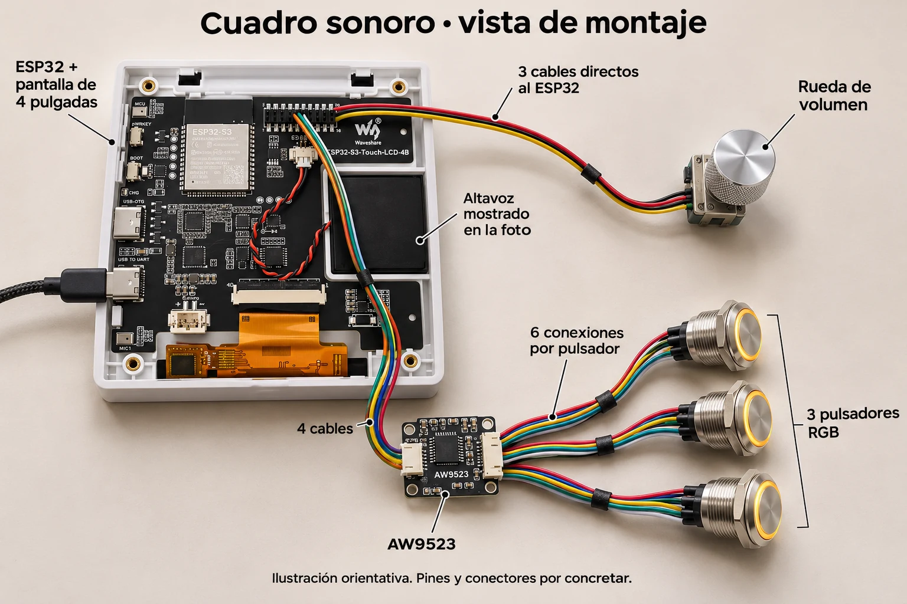

# Firmware ESP32 — fase pendiente

## Referencia visual de conexiones y montaje

La ilustración ayuda a imaginar la disposición general del controlador, pantalla, altavoz, rueda y pulsadores. Es un croquis visual preliminar y no representa el cableado propuesto actual ni instrucciones para energizar componentes. La selección, lista de materiales, esquema propuesto y comprobaciones pendientes están en [Hardware del primer prototipo](../docs/HARDWARE.md); el montaje y su validación física siguen pendientes.

Todavía no hay firmware ejecutable ni comandos de compilación/carga. La placa y los componentes del primer prototipo están seleccionados, pero el montaje y el pinout propuesto aún no se han validado físicamente. Se documentarán y probarán los comandos al elegir el entorno de desarrollo.

Requisitos acordados: identificador fijo asignado al cuadro; tres botones iluminados; rueda de volumen; pantalla a color; streaming Wi-Fi con búfer, sin microSD; arranque silencioso; una canción termina y se detiene. El ESP32 consulta configuración/medios de Firebase y reproduce MP3 desde Storage o emisoras desde sus streams; no aloja la web musical. El portal local es independiente y configura Wi-Fi sin Internet, Render ni Firebase. En primera instalación, el dispositivo crea un punto de acceso temporal protegido con contraseña propia, muestra un QR de conexión y abre un asistente local; la contraseña doméstica solo se guarda en el ESP32. Distinguir conexión al router de disponibilidad de Internet, sin borrar credenciales por una caída de Internet. Con credenciales guardadas, los fallos temporales no abren solos el asistente.

Pulsaciones cortas controlan los huecos. Mantener botón 1 durante 2 segundos muestra 20 segundos el QR habitual `https://sonoro.zeliuk.xyz/#token=<id-cuadro>` sin afectar a la reproducción; después la pantalla vuelve al estado visual actual. Mantener botones 2 y 3 juntos durante 5 segundos completa una cuenta atrás cancelable soltando cualquiera de ellos; entonces borra únicamente la Wi-Fi y abre el asistente. Se conservan identificador, selecciones, imagen decorativa y volumen. La rueda solo ajusta el volumen y no requiere pulsación. Las acciones largas/combinadas no deben ejecutar acciones cortas; 2+3 tiene prioridad y mantener no repite la acción.

Estos son comportamientos acordados, no implementados. Los tiempos y dirección local definitiva del portal se validarán con hardware. Los componentes para el primer prototipo y un cableado propuesto están documentados en [docs/HARDWARE.md](../docs/HARDWARE.md), pero montaje, características recibidas, pines, alimentación y funcionamiento todavía requieren comprobación física. Las librerías no están elegidas; WiFiManager puede evaluarse como candidato, no es dependencia ni decisión técnica. No hay todavía firmware ejecutable ni comandos de compilación/carga.

Cambiar una selección no interrumpe la reproducción activa; la nueva se usa en la siguiente activación. El guardado web no inicia ni detiene audio físico. La web y el cuadro tienen reproducciones y volúmenes independientes. El familiar no instala herramientas ni introduce credenciales técnicas; solo configura su Wi-Fi.

La placa, pantalla, expansor y controles para el primer prototipo ya están seleccionados en la lista de materiales de [docs/HARDWARE.md](../docs/HARDWARE.md). Esta selección no valida las piezas recibidas, el esquema, la alimentación ni el montaje; siguen pendientes la comprobación de banco, la construcción y la validación física. Antes de implementar el firmware, validar también el flujo de la web pública; el reporte de Carlos de backend RapidAPI no valida el dispositivo. Al implementarlo, añadir requisitos/versiones, configuración privada, compilación, USB, monitor serie, prueba de audio/pantalla/botones, recuperación de red y restablecimiento. Nunca incorporar tokens reales, Wi-Fi o credenciales Admin SDK al repositorio.
